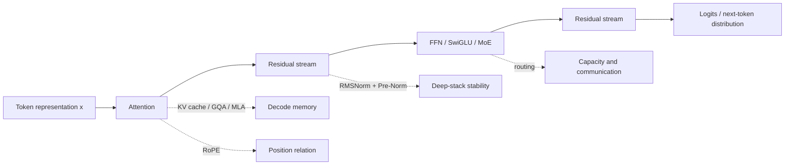
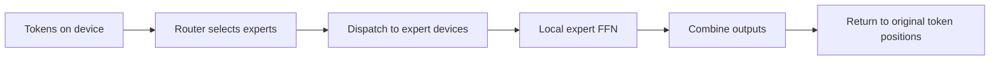

# 7 Transformer and LLM

> Lecture 10｜Transformer and Modern LLM
>
> 本章承接 [[5 Attention and Transformer]] 与 [[6 Transformer variants and applications]]。上一章已经讲过 attention、Transformer block、长序列 attention pattern 和基本模型家族；本章进一步问：**现代 LLM 为什么要改变 FFN、KV cache、位置编码和归一化？这些改动分别解决哪一个系统瓶颈？**

> [!tip] 可视化 companion
>
> ![[assets/7 Transformer and llm/figure/modern-decoder-figure.svg|现代 decoder 的总览、MoE 局部路径与系统后果]]
>
> **交互入口**：[[互动实验入口]] · [[assets/7 Transformer and llm/visual/architecture-costs.html|打开 Modern decoder 视觉交互]]。如果 Obsidian 不允许在笔记内嵌 HTML，直接打开该本地页面；上面的 SVG、下方静态表和课件截图构成完整回退。

**交互静态回退**：若 Obsidian 未加载 HTML，下面的课件数字仍可独立阅读。MoE 的 top-2 示例见 p.14、负载对比见 p.16；KV cache 的数值采用 p.30 的 toy model；FlashAttention 的 IO 结论来自 p.32。

| 对照 | 课件案例 / 静态值 | 读图结论 |
|---|---|---|
| MoE 负载 | 均衡 `25/25/25/25`；集中 `85/5/5/5`（每 100 routed assignments） | 相同 0–100 刻度下看热点和空闲 expert |
| MoE 单 token | `p=[0.50,0.30,0.15,0.05]`；top-2 权重 `g=[0.625,0.375,0,0]`；`y=[1.25,1.50]` | 只执行 Expert 1、2；权重由 top-2 概率重新归一化 |
| KV cache | Q heads 固定为 4；KV heads `4 → 2 → 1`；cache `2 → 1 → 0.5 GiB` | 共享 K/V head 减少缓存副本，不减少 token 位置 |
| FlashAttention | tile 化把局部计算放在 SRAM；避免物化并反复写回完整 attention matrix | 数学 attention operator 不变（允许数值舍入差异）；persistent KV cache 仍由架构决定 |

## 学习导航

本章默认面向已经读过前 6 节、但没有参加 Lecture 10 的学习者。你不需要记住每个模型的名字，但需要能沿着一条数据路径解释每个设计选择：**输入 token → attention / FFN → residual stream → 下一个 token；同时指出计算、存储、通信和训练稳定性代价。**

| 章节 | 关键词 | 读完后应能做什么 |
|---|---|---|
| 1 | scaling laws | 解释参数量 $P$、训练 token 数 $D$ 和计算量 $C$ 为什么要一起规划 |
| 2 | FFN、SwiGLU、MoE | 解释 dense capacity、active parameters、router 和 load balance |
| 3 | prefill、decode、KV cache | 从张量轴推导缓存大小，并区分 MHA、GQA、MQA、MLA |
| 4 | FlashAttention | 区分“减少算子计算”和“减少中间结果搬运” |
| 5 | RoPE | 解释旋转位置编码为什么让 Q/K 内积携带相对位置信息 |
| 6 | RMSNorm、Pre-Norm | 解释 residual stream、梯度路径和深层稳定性 |
| 7 | Llama 3、DeepSeek-V3 | 把多个模块组合成完整架构，并从系统视角比较 |

### 术语路线图

```text
资源问题：模型、数据、计算、内存、通信
  -> FFN capacity -> SwiGLU -> sparse MoE -> routing
  -> attention state -> prefill/decode -> KV cache -> GQA/MQA/MLA
  -> IO bottleneck -> FlashAttention
  -> position -> RoPE -> long-context extrapolation
  -> deep stack -> RMSNorm -> Pre-Norm -> residual scale
  -> architecture cases -> Llama 3 / DeepSeek-V3
```

## 1. 为什么现代 LLM 的 block 需要重新设计

### 1.1 先把“模型效果”拆成资源问题

一个 decoder-only Transformer block 可以抽象为两条子层路径：

1. **Attention**：每个 token 从可见的历史 token 中读取上下文；
2. **FFN**：每个 token 独立经过一个非线性特征变换。

在训练阶段，整段序列已经存在，矩阵乘法可以批量并行；在自回归解码阶段，每次只能新增一个 token，但新 token 需要读取越来越长的历史。于是同一个 block 在不同阶段有不同瓶颈：

| 阶段 | 主要工作 | 典型压力 |
|---|---|---|
| Training | 一次处理很多 token | 总 FLOPs、激活保存、跨设备通信 |
| Prefill | 一次处理 prompt 全部 token | 大矩阵计算、attention 中间结果 |
| Decode | 每次处理一个新 token | 读取历史 K/V、memory bandwidth、端到端 latency |

> [!important] 核心判断
> “Transformer 更容易并行”主要描述训练和 prefill；它不等于自回归生成可以并行地产生所有未来 token。decode 仍然受因果依赖限制。

### 1.2 一张总图：每个改动对应一个瓶颈



**读图**：沿主路径看 token 表示如何通过 attention 和 FFN；再看四条虚线分别改变什么。它们不是四个互不相关的技巧，而是对不同张量或系统资源的局部改造。

#### 论文式静态教学图：总览 → 局部机制 → 系统后果

这张 teaching figure 借鉴 Transformer 的总览架构、FlashAttention 的“资源层级 → 数据搬运 → 结果”和 MoE 论文的 routing 图式。左侧先定位主路径，中间追踪一个 token 的局部路由，右侧再回答“这个改动省了什么、增加了什么”。图中的绿色和橙色标记是教学标注，不是课件原图中的新模型结论。

图已在本章开头的可视化 companion 中显示；这里继续沿“总览 → 局部机制 → 系统后果”顺序解读同一张图。

**读图结论**：先从 `token x` 沿主路径走到输出，再追踪一个 token 被 router 送到哪些 expert，最后把 active compute、KV cache、HBM traffic 和训练稳定性分开判断。

### 1.3 课件来源图

![[assets/7 Transformer and llm/source/p3.png|课件 p.3：现代 decoder block 的代表性结构]]

这张图是课件的总览。它标出的三个变化是：在每个子层前做 normalization、把 position 放进 attention、给 FFN 加 gate。课件明确说明这是 **a representative decoder block, not a universal specification**；不要把它误解成所有现代模型都完全一样。

## 2. Scaling laws：为什么模型和数据要一起扩大

### 2.1 三个量：参数、数据、计算

令：

- $P$：模型参数量（parameters）；
- $D$：训练 token 数（training tokens）；
- $C$：训练计算量（compute，常用 FLOPs 近似）。

课件使用 dense-model 的近似：

$$
C \approx 6PD.
$$

这个式子不是所有训练系统的精确成本账单。它忽略了长上下文 attention、通信、数据读取、优化器额外状态和硬件利用率；它的作用是说明一个基本约束：**在固定计算预算下，模型更大通常意味着可以处理的训练 token 更少。**

课件 p.5 的例子：若 $C\approx 6\times 10^{21}$ FLOPs，则：

| 参数量 $P$ | 可分配 token 数 $D\approx C/(6P)$ | 直觉 |
|---:|---:|---|
| 1B | 1T | 模型较小，数据较多 |
| 2B | 500B | 参数翻倍，token 约减半 |
| 4B | 250B | 参数再翻倍，数据继续减少 |

这里的 `B` 是 billion，`T` 是 trillion。数字是课件的 illustrative calculation，不是某个模型的训练配方。

### 2.2 联合 scaling law

课件给出一个拟合形式：

$$
L(P,D)\approx E+\frac{A}{P^{\alpha}}+\frac{B}{D^{\beta}}.
$$

其中：

- $L(P,D)$：模型在某个评估设置下的 loss；
- $E$：拟合中的 loss floor；
- $A/P^\alpha$：模型容量不足造成的惩罚；
- $B/D^\beta$：训练数据不足造成的惩罚。

这个表达式告诉我们，增加参数和增加数据都可能降低 loss，但收益会递减。固定 $C$ 时，如果只增加 $P$，由 $D\approx C/(6P)$ 可知数据惩罚会变大；如果只增加 $D$，模型容量不足又会成为限制。

### 2.3 Compute-optimal scaling

课件采用 Chinchilla 风格的结论：在理想化的 compute-optimal 区域，参数量和训练数据量都随计算预算的平方根增长：

$$
P_{\mathrm{opt}}\propto C^{0.5},\qquad D_{\mathrm{opt}}\propto C^{0.5}.
$$

因此，计算量增加 4 倍时，理想化地大约把参数和 token 都增加 2 倍。课件还提醒“每个参数约 20 个 training tokens”只是历史经验法则，不是普适常数；最佳比例取决于数据质量、训练目标、上下文长度和部署目标。

> [!note] 联网补充：为什么只看 loss 不够
> Kaplan et al.（2020）展示了语言模型 loss 的幂律趋势；Hoffmann et al.（2022）进一步强调，在固定 compute 下，较小模型配合更多训练 token 可能更接近 compute-optimal。现实训练还受数据重复、质量过滤、通信、checkpoint、上下文长度和 lifetime inference cost 影响，因此 scaling law 是规划工具，不是效果保证。

来源： [Kaplan et al., 2020](https://arxiv.org/abs/2001.08361)；[Hoffmann et al., 2022](https://arxiv.org/abs/2203.15556)。

## 3. FFN、SwiGLU 与 Mixture of Experts

### 3.1 FFN 在 block 里做什么

Attention 负责 token 之间的信息读取；FFN（feed-forward network，前馈网络）在每个 token 的表示上独立做特征变换。最基本的 FFN 是：

$$
\operatorname{FFN}(x)=W_2\,\sigma(W_1x+b_1)+b_2.
$$

若输入宽度是 $d$，中间宽度是 $m$：

```text
x: d  ->  W1 + activation: m  ->  W2: d
```

它先扩张特征维度、加入非线性，再压回 residual stream 的宽度。一个 dense FFN 对每个 token 都使用同一组参数。

### 3.2 为什么要 gate

SwiGLU 把中间特征拆成两条路径：一条产生 gate，一条产生 value：

$$
y=W_{\mathrm{down}}\left[\operatorname{SiLU}(W_{\mathrm{gate}}x)\odot(W_{\mathrm{up}}x)\right].
$$

其中：

- $W_{\mathrm{gate}}x$ 产生输入依赖的 gate；
- $W_{\mathrm{up}}x$ 产生要被调制的 value；
- $\odot$ 是逐元素乘法；
- $\operatorname{SiLU}(z)=z\,\sigma(z)$。

和 sigmoid gate 不同，SwiGLU 的 SiLU 输出不受限于 $[0,1]$；它可以放大、抑制或改变符号。它的表达力来自“根据当前 token 内容选择哪些中间特征通过”。

### 3.3 参数预算不能直接比较宽度

ReLU/GELU FFN 若中间宽度为 $4d$，两张投影矩阵参数量近似：

$$
(4d\times d)+(d\times 4d)=8d^2.
$$

SwiGLU 有两张输入投影和一张下投影，若中间宽度为 $m$：

$$
(m\times d)+(m\times d)+(d\times m)=3dm.
$$

如果希望参数预算大致相同：

$$
3dm=8d^2\Rightarrow m=\frac{8d}{3}.
$$

所以比较激活函数时要先匹配参数预算；直接把 ReLU 的宽度 $4d$ 和 SwiGLU 的宽度 $4d$ 放在一起比较，会把“参数更多”的收益误归因于激活函数。

### 3.4 MoE：把一个共享 FFN 换成多个 expert

MoE（mixture of experts，专家混合）把单个 FFN 替换成多个 expert FFN，并加入 router。对 token 表示 $x$，router 产生各 expert 的分数，选择 top-$k$ 个 expert：

$$
y=\sum_{e\in T(x)}g_e(x)E_e(x).
$$

其中 $T(x)$ 是被选中的 expert 集合，$g_e(x)$ 是归一化后的路由权重。

**重点区分两个参数量：**

- total parameters：模型中存储的所有 expert 参数；
- active parameters：当前 token 实际执行的共享参数加 top-$k$ experts。

课件 p.15 的玩具例子：1B always-active 参数 + 8 个 1B experts；top-2 routing 时 total 是 9B，但每个 token active 约 3B。它不意味着只需要存 3B 参数，所有 expert 仍然要存储，并且分布式路由需要通信。

### 3.5 Top-2 routing 的完整小例子

课件给出一个 token 的 router 概率：

| Expert | 1 | 2 | 3 | 4 |
|---|---:|---:|---:|---:|
| router probability | 0.50 | 0.30 | 0.15 | 0.05 |
| selected weight | 0.625 | 0.375 | 0 | 0 |

选择 expert 1 和 2 后，假设：

$$
E_1(x)=[2,0],\qquad E_2(x)=[0,4].
$$

则：

$$
y=0.625[2,0]+0.375[0,4]=[1.25,1.50].
$$

expert 3、4 对这个 token 不执行。这里的 selected weights 是把 top-2 的概率重新归一化：$0.50/(0.50+0.30)=0.625$。

### 3.6 为什么 routing 会 collapse

如果 router 把大量 token 都送给少数 expert，会出现两类问题：

1. 热门 expert 计算过载，其他 expert 空闲；
2. token dispatch 和 all-to-all 通信出现热点，端到端 throughput 下降。

课件中的负载平衡项写成：

$$
L_{\mathrm{balance}}=\alpha N\sum_i f_i\bar p_i,
$$

其中 $f_i$ 可以理解为被分配到 expert $i$ 的 token 比例，$\bar p_i$ 是 router 对该 expert 的平均概率。实际模型还会结合 capacity limit、token dropping、router z-loss 或 bias correction 等机制，具体取决于实现。

DeepSeek-V3 风格的 bias update 思路是：观察到某 expert 超载就降低其 bias，使它之后较不容易被选中；低于目标负载则提高 bias。要区分：修正后的 score 用来选择 expert，原始 score 仍可用于组合输出。

### 3.7 Expert parallelism 的系统代价

当不同设备拥有不同 experts 时，一个 token 的路径是：



MoE 省下的是每个 token 的 active compute，却可能增加：路由计算、跨设备 all-to-all、负载不均衡、容量溢出和通信等待。因此评估 MoE 不能只看 active parameters 或理论 FLOPs，要测 communication、expert utilization 和 end-to-end throughput。

## 4. Attention 与 KV cache：推理时到底保存什么

### 4.1 一个 attention head 的 decode 公式

在第 $t$ 个 token 处：

$$
q_t=x_tW_Q,\qquad k_t=x_tW_K,\qquad v_t=x_tW_V.
$$

如果只允许读取位置 $1$ 到 $t$：

$$
o_t=\operatorname{softmax}\left(\frac{q_tK_{1:t}^{T}}{\sqrt{d_h}}\right)V_{1:t}.
$$

shape 是：

| 张量 | 作用 | shape |
|---|---|---|
| $q_t$ | 当前 query | $1\times d_h$ |
| $K_{1:t}$ | 所有可见 keys | $t\times d_h$ |
| $V_{1:t}$ | 所有可见 values | $t\times d_h$ |
| score | 当前 query 对历史位置的分数 | $1\times t$ |

### 4.2 Prefill 与 decode 是两种不同工作负载

给定 prompt `A B C`，模型生成 `D E F ...`：

| 阶段 | 本次处理的 token | 之后可用的 KV positions | 下一 token |
|---|---|---|---|
| Prefill | A、B、C 一起 | 1–3 | D |
| Decode 1 | D | 1–4 | E |
| Decode 2 | E | 1–5 | F |

Prefill 可以把 prompt 的多个位置放进一次带 causal mask 的矩阵计算；decode 每次只有一个新 query，但要读取越来越长的历史 K/V。**这就是为什么 decode 常被 memory bandwidth 而不是矩阵乘法峰值限制。**

### 4.3 KV cache 为什么不保存 Q

追加一个 token 时：

$$
K_{1:t}=[K_{1:t-1};k_t],\qquad V_{1:t}=[V_{1:t-1};v_t].
$$

过去的 K/V 仍会被未来 query 读取，所以缓存；过去的 Q 只服务于过去已经完成的输出，未来不会重新读取旧 Q，所以不需要 attention cache。每层都需要保存自己的 K/V。

### 4.4 MHA、MQA、GQA

设 query head 数 $H_Q=4$：

| 架构 | $Q$ heads | $K/V$ heads | 共享关系 | KV cache / MHA |
|---|---:|---:|---|---:|
| MHA | 4 | 4 | 每个 Q head 一组 K/V | 1 |
| GQA | 4 | 2 | 两个 Q head 共享一组 K/V | $1/2$ |
| MQA | 4 | 1 | 所有 Q head 共享一组 K/V | $1/4$ |

![[assets/7 Transformer and llm/source/p29.png|课件 p.29：MHA、GQA、MQA 的 tensor shapes]]

三者的 attention score shape 都可以是 $[B,4,1,t]$；减少 KV heads 不会删除 token positions，也不会把 Q heads 变少。变化的是保存的 K/V head 数。

#### 共享 K/V 不等于共享 attention output

课件 p.28 用标量例子说明：

$$
K=[1,-1]^T,\qquad V=[10,20]^T.
$$

两个 query 共享同一组 K/V，但因为 query 不同，score 和 softmax 权重不同：

| query | weights | output |
|---|---|---:|
| $q_1=\frac12\ln3$ | $[0.75,0.25]$ | $12.5$ |
| $q_2=-\frac12\ln3$ | $[0.25,0.75]$ | $17.5$ |

所以共享 K/V 仍允许不同 query 选择不同的 value 混合。

### 4.5 KV cache memory 公式

课件给出：

$$
\mathrm{Bytes}=2\times L\times B\times t\times H_{KV}\times d_h\times s.
$$

解释：

- 第一个 2：K 和 V 两份；
- $L$：层数；
- $B$：batch / sequence 数；
- $t$：已缓存 token 数；
- $H_{KV}$：KV heads 数；
- $d_h$：每个 head 宽度；
- $s$：每个 value 的字节数，例如 bf16 为 2 bytes。

课件 toy setting：$L=32$、$B=1$、$t=32768$、$d_h=128$、$s=2$，固定 4 个 Q heads：

| 架构 | KV heads | cache |
|---|---:|---:|
| MHA | 4 | 2 GiB |
| GQA | 2 | 1 GiB |
| MQA | 1 | 0.5 GiB |

这些数字只计算 KV cache，不包括模型 weights、activations、allocator overhead 或其他 runtime buffer。

### 4.6 MLA：缓存低秩 latent state

MLA（Multi-Head Latent Attention）进一步不直接缓存完整的每个 K/V head，而是缓存一个较窄的 latent：

$$
c_t^{KV}=x_tW_{\mathrm{down}},\qquad
k_t^h=c_t^{KV}W_{K^h},\qquad
v_t^h=c_t^{KV}W_{V^h}.
$$

如果 latent width 是 $r$，另有位置 key width $d_R$，每个 token/layer 的缓存可近似写成 $r+d_R$，而 GQA 需要存 $2H_{KV}d_h$。MLA 的代价是额外的投影/重建路径与更复杂的位置处理；它把 cache 压缩换成计算和实现复杂度。

## 5. FlashAttention：不改变 attention，改变 IO

### 5.1 先区分两个问题

标准 attention：

$$
S=QK^T/\sqrt{d_k},\qquad A=\operatorname{softmax}(S),\qquad Y=AV.
$$

在朴素实现中，$S$ 或 $A$ 是 $N\times N$ 的中间矩阵，可能写入 device memory，再读回来继续计算。长序列时，问题不只是乘法次数，还包括 HBM / SRAM 之间的数据搬运。

FlashAttention 的核心不是改变数学算子，而是：

1. 把 Q、K、V 分成 tile；
2. 在片上快速 memory 中计算局部 score；
3. 用 online softmax 累积每行的归一化统计量；
4. 不把完整 attention matrix 写回 device memory。

因此它通常被称为 IO-aware exact attention：在数值舍入范围内保持同一 attention operator，但减少 HBM 读写。

![[assets/7 Transformer and llm/source/p32.png|课件 p.32：FlashAttention 通过 tiling 减少 memory traffic]]

### 5.2 FlashAttention 没有解决什么

- 它不自动缩小持久化的 KV cache；cache 仍由 $L,B,t,H_{KV},d_h,s$ 决定；
- 它不把标准 attention 的理论连接数从 $N^2$ 变成线性；
- 它需要适合硬件的 fused kernel、tile size 和精确的数值处理；
- 在 decode 阶段，历史 K/V 的读取仍可能是主要成本。

## 6. 位置编码：RoPE 为什么适合 attention

### 6.1 没有位置编码时的问题

self-attention 对输入 token 做内容相关的加权混合，但如果只看集合中的 token 向量，不看 index，模型很难区分同样 token 的不同顺序。绝对位置向量可以加到 token embedding 上，但长上下文外推还要考虑训练长度之外的行为。

### 6.2 RoPE 的二维旋转

RoPE（Rotary Position Embedding）把每两个特征组成一个二维平面，在位置 $m$ 旋转 query，在位置 $n$ 旋转 key：

$$
q'_m=R_mq_m,\qquad k'_n=R_nk_n.
$$

旋转矩阵可写为：

$$
R_m(\theta)=
\begin{bmatrix}
\cos(m\theta)&-\sin(m\theta)\\
\sin(m\theta)&\cos(m\theta)
\end{bmatrix}.
$$

因为旋转矩阵满足 $R_m^TR_n=R_{n-m}$，旋转后的内积可以依赖相对位置差：

$$
(R_mq)^T(R_nk)=q^TR_m^TR_nk=q^TR_{n-m}k.
$$

这不是说模型只知道距离而不知道内容；内容仍由 $q,k$ 决定，RoPE 让匹配分数同时携带位置关系。

![[assets/7 Transformer and llm/source/p37.png|课件 p.37：RoPE 在 Q/K 特征对子上旋转]]

### 6.3 长上下文的边界

一个 computable position vector 不保证在训练长度之外可靠。长上下文扩展需要考虑：

- 旋转频率如何缩放；
- 训练时见过的最大位置；
- attention sink、远距离依赖和数据分布；
- 推理时 KV cache 和 attention kernel 的成本。

YaRN 等方法通过位置频率重缩放与少量长上下文适配，尝试在不完全重训的情况下扩大 context window；这是外部补充，不应被理解为 RoPE 的自动性质。

来源： [RoFormer / RoPE](https://arxiv.org/abs/2104.09864)；[YaRN](https://arxiv.org/abs/2309.00071)。

## 7. RMSNorm、Pre-Norm 与 residual stream

### 7.1 LayerNorm 与 RMSNorm

LayerNorm 对一个向量 $x\in\mathbb{R}^d$ 先减均值、再除标准差：

$$
\operatorname{LN}(x)=\gamma\odot\frac{x-\mu}{\sqrt{\sigma^2+\epsilon}}+\beta.
$$

RMSNorm 不减均值，只控制 root mean square：

$$
\operatorname{RMSNorm}(x)=\gamma\odot\frac{x}{\sqrt{\frac1d\sum_{i=1}^{d}x_i^2+\epsilon}}.
$$

直觉上，RMSNorm 更关注向量整体尺度，而不是强制每个 token 的 feature 均值为 0。课件 p.41 的 toy calculation 展示了两者输出不同；真实模型通常还有 learned scale $\gamma$ 和非零 epsilon。

### 7.2 Post-Norm 与 Pre-Norm

Post-Norm：

$$
y=\operatorname{Norm}(x+F(x)).
$$

Pre-Norm：

$$
y=x+F(\operatorname{Norm}(x)).
$$

Pre-Norm 的直接 identity path 使梯度可以沿 $x$ 直接穿过：

$$
\frac{\partial y}{\partial x}=I+J_FJ_{\mathrm{Norm}}.
$$

这有助于深层 stack 的训练稳定性，但不是“Pre-Norm 永远更好”的证明；最终仍要结合 initialization、residual scaling、训练稳定性和任务质量评估。

### 7.3 Residual branch 的尺度

一个带 branch scale 的 residual 更新：

$$
x_{\ell+1}=x_\ell+a_\ell F_\ell(\operatorname{Norm}(x_\ell)).
$$

在弱相关近似下：

$$
\operatorname{Var}(x_{\ell+1})\approx \operatorname{Var}(x_\ell)+a_\ell^2\operatorname{Var}(F_\ell).
$$

层数增加时，很多 branch 的累积可能改变 residual stream 的尺度，因此初始化、branch scaling 和 normalization 要一起设计。

## 8. 两个架构案例

### 8.1 Llama 3 8B：dense decoder 的组合

课件 p.45 给出的配置：

| 组件 | Llama 3 8B 配置 |
|---|---|
| depth / hidden width | 32 layers / 4096 |
| FFN | dense SwiGLU，intermediate width 14336 |
| attention | 32 query heads、8 K/V heads，即 GQA |
| position | RoPE |
| norm / residual | Pre-Norm + RMSNorm |

这个案例的学习价值不是背配置，而是看出一个完整组合：SwiGLU 增强 token-wise capacity；GQA 减少 KV cache；RoPE 注入位置；RMSNorm + Pre-Norm 支持深层训练。

### 8.2 DeepSeek-V3：sparse decoder 的组合

课件 p.46–47 给出：总参数约 671B，active 参数约 37B；使用 routed FFN（MoE）、MLA（compact KV state）和特殊的位置路径。

这里要区分：

- total parameter 大，说明模型存储和专家容量很大；
- active parameter 小，说明每个 token 的计算只走一部分专家；
- MLA 主要压缩 attention 的缓存状态；
- routing 和 expert parallelism 可能增加通信与负载均衡问题。

### 8.3 比较时要问四个问题

| 问题 | Llama 3 dense | DeepSeek-V3 sparse |
|---|---|---|
| FFN capacity | dense SwiGLU | routed experts |
| attention state | GQA 共享 K/V | MLA latent state |
| position | RoPE | decoupled position path |
| 系统风险 | 计算与 cache 仍随规模增长 | routing、通信和 load balance 更复杂 |

> [!important] 架构分析模板
> 对任何新模型，先列出：**哪种 tensor 变了？哪部分计算被跳过？哪部分 memory 被压缩？增加了什么通信或近似误差？训练和 decode 的收益是否相同？**

## 9. 从课件图读系统

### 9.1 先看主路径，再看资源路径

当你看到一张现代 decoder 图，不要先背模块名。按这条路线读：

1. token 表示从哪里进入？
2. attention 读取哪些 K/V？
3. residual stream 在哪里相加？
4. FFN 是 dense、gated 还是 routed？
5. position 在 Q/K 的哪一步进入？
6. normalization 在子层之前还是之后？
7. decode 时哪些张量要跨层、跨设备或跨内存层级保存？

### 9.2 课件案例截图索引

| case ID | 来源页 | 图像 | 学习用途 |
|---|---:|---|---|
| T7-01 | p.3 | `source/p3.png` | 现代 decoder block 总览 |
| T7-02 | p.14 | `source/p14.png` | Top-2 routing 计算 |
| T7-03 | p.16 | `source/p16.png` | routing collapse 与负载平衡 |
| T7-04 | p.19 | `source/p19.png` | expert parallelism 通信 |
| T7-05 | p.29 | `source/p29.png` | MHA/GQA/MQA shape 对比 |
| T7-06 | p.30 | `source/p30.png` | KV cache memory |
| T7-07 | p.32 | `source/p32.png` | FlashAttention tiling |
| T7-08 | p.37 | `source/p37.png` | RoPE |
| T7-09 | p.41–43 | `source/p40.png`, `source/p42.png` | RMSNorm、Pre-Norm、residual scale |
| T7-10 | p.45–47 | `source/p44.png` | Llama 3 与 DeepSeek-V3 |

### 案例图册（按需展开）

下面保留课件案例的原始页面。先读上文的解释，再展开对应案例，可以把公式、张量形状和系统图与老师的原始表达对照起来。

<details><summary>T7-01：现代 decoder block 总览（p.3）</summary>

![[assets/7 Transformer and llm/source/p3.png|课件 p.3：现代 decoder block 总览]]
</details>

<details><summary>T7-02：Top-2 routing 计算（p.14）</summary>

![[assets/7 Transformer and llm/source/p14.png|课件 p.14：Top-2 routing 计算]]
</details>

<details><summary>T7-03：routing collapse 与负载平衡（p.16）</summary>

![[assets/7 Transformer and llm/source/p16.png|课件 p.16：routing collapse 与负载平衡]]
</details>

<details><summary>T7-04：expert parallelism 通信（p.19）</summary>

![[assets/7 Transformer and llm/source/p19.png|课件 p.19：expert parallelism 通信]]
</details>

<details><summary>T7-05：MHA、GQA、MQA 的 shape 对比（p.29）</summary>

![[assets/7 Transformer and llm/source/p29.png|课件 p.29：MHA、GQA、MQA 的 tensor shapes]]
</details>

<details><summary>T7-06：KV cache memory（p.30）</summary>

![[assets/7 Transformer and llm/source/p30.png|课件 p.30：KV cache memory]]
</details>

<details><summary>T7-07：FlashAttention tiling（p.32）</summary>

![[assets/7 Transformer and llm/source/p32.png|课件 p.32：FlashAttention tiling]]
</details>

<details><summary>T7-08：RoPE（p.37）</summary>

![[assets/7 Transformer and llm/source/p37.png|课件 p.37：RoPE]]
</details>

<details><summary>T7-09：RMSNorm、Pre-Norm、residual scale（p.41–43）</summary>

![[assets/7 Transformer and llm/source/p40.png|课件 p.40：RMSNorm 与 Pre-Norm]]

![[assets/7 Transformer and llm/source/p42.png|课件 p.42：residual scale]]
</details>

<details><summary>T7-10：Llama 3 与 DeepSeek-V3（p.45–47）</summary>

![[assets/7 Transformer and llm/source/p44.png|课件 p.44：Llama 3 与 DeepSeek-V3]]
</details>

## 10. 本章整合

```text
Scaling law 决定资源预算
  -> FFN / MoE 决定每个 token 的容量与 active compute
  -> Attention / KV cache 决定 decode 的状态与带宽
  -> GQA / MQA / MLA 压缩缓存
  -> FlashAttention 减少 attention 中间结果 IO
  -> RoPE 提供相对位置关系
  -> RMSNorm + Pre-Norm 稳定深层 residual stream
  -> Llama 3 / DeepSeek-V3 把这些选择组合成可部署架构
```

你现在应该能回答：一个设计为什么更省？它省的是 FLOPs、峰值内存、HBM traffic、KV cache、通信，还是训练参数？如果无法指出具体张量，就说明还停留在模型名称记忆，而没有完成系统级理解。

## 参考资料与外部补充

- 课件：`Transformer and llm.pdf`，Lecture 10，Lan Xu，CS 280 Deep Learning，p.1–47。
- Vaswani et al. (2017), [Attention Is All You Need](https://arxiv.org/abs/1706.03762)。
- Shazeer (2019), [Fast Transformer Decoding: One Write-Head is All You Need](https://arxiv.org/abs/1911.02150)。
- Ainslie et al. (2023), [GQA: Training Generalized Multi-Query Transformer Models from Multi-Head Checkpoints](https://arxiv.org/abs/2305.13245)。
- Dao et al. (2022), [FlashAttention](https://arxiv.org/abs/2205.14135)。
- Su et al. (2021), [RoFormer: Enhanced Transformer with Rotary Position Embedding](https://arxiv.org/abs/2104.09864)。
- DeepSeek-AI (2024), [DeepSeek-V2](https://arxiv.org/abs/2405.04434)。
- 来源图均为本地课件截图；截图只用于保留老师的案例和图示证据，正文解释以本笔记为准。
