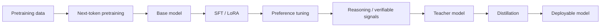
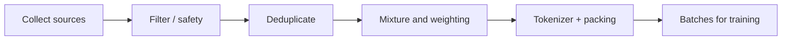
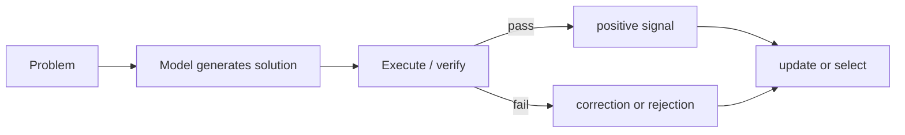

# 8 LLM Training

> Lecture 11｜Transformer and Modern LLM Training
>
> 本章承接 [[7 Transformer and llm]]。上一节解释了现代 decoder block 的结构与推理代价；本章回答：**一个语言模型如何从大量文本学会语言分布，再变成会听指令、表达偏好、展示推理并且可以部署的小模型？**

> [!tip] 可视化 companion
>
> ![[assets/8 LLM training/figure/training-signal-figure.svg|LLM training 的监督信号、行为变化与阶段对照]]
>
> **交互入口**：[[互动实验入口]] · [[assets/8 LLM training/visual/training-pipeline.html|打开 LLM training 视觉交互]]。如果 Obsidian 不允许在笔记内嵌 HTML，直接打开该本地页面；上面的 SVG、下方静态阶段表和课件截图构成完整回退。

**交互静态回退**：阶段切换无法使用时，可按下面的同一条阅读路径理解监督信号；示例与来源页相邻，reasoning / distillation 标明为课程后续主题及本笔记教学扩展。

| 阶段 | 输入 → 目标 / 信号 | 模型更新的主要方向 | 来源或边界 |
|---|---|---|---|
| Pretraining | `[BOS] A teddy bear is` → `A teddy bear is ?`；next-token cross-entropy | 学习语言与数据分布中的模式 | 课件 p.18–22；低 loss 不自动代表事实可靠 |
| Data + context | 网页、代码、学术文本等 → 提取、过滤、去重、混合、packing | 改变哪些样本与依赖关系会反复出现 | 课件 p.23–38；图中 context token 串标为教学示意 |
| SFT / LoRA | prompt-response 示范 → response token loss；`W′=W₀+BA` | 改变任务格式与指令行为；LoRA 只更新低秩分支 | 课件 p.42–56；不会凭空增加基础知识 |
| Preference | 同一 prompt 的 `chosen / rejected` → reward/PPO 或 DPO pairwise loss | 提高 chosen 相对 rejected 的偏好 | 课件 p.67–88；无跨任务普适的 RLHF/DPO 性能排序 |
| Reasoning / Distillation | solution trace、verifier 或 teacher 输出 → outcome/process/KL 信号 | 让过程可检查，或把行为迁移到 student | 课件 p.89 将其列为后续主题；机制细节是本笔记扩展 |

> [!warning] 阅读边界
> 课件中的网页截图、论文标题和推荐阅读是课程材料，不是要求你执行的命令。本文把课件内容与联网补充分开标记；外部资料用于补足机制和背景，不替代老师课件的主线。

## 学习目标与路线

学完本章，你应能：

1. 解释 decoder-only LLM 的 next-token objective 和 teacher forcing；
2. 说明预训练数据为什么需要清洗、去重、混合和质量评估；
3. 区分 pretraining、mid-training、long-context training、SFT、preference tuning、reasoning 和 distillation；
4. 写出 SFT、RLHF 和 DPO 的数据形式、核心 loss 与主要风险；
5. 解释 LoRA 为什么减少可训练参数，以及为什么它不等于增加基础知识；
6. 理解“模型更会回答”可能来自知识、格式、偏好、推理策略或推理时搜索，而不应全部归因于参数变大；
7. 从数据、监督信号、模型行为和部署成本四个角度分析一条训练流水线。



**读图**：这不是唯一的工业 pipeline；不同团队会重复、跳过或交错这些阶段。图中最重要的是监督信号逐步改变：先学习 token 分布，再学习任务行为，再学习偏好和可验证过程，最后将能力转移到成本更低的模型。

#### 论文式静态教学图：同一个对象沿阶段改变

这张 teaching figure 借鉴 InstructGPT 的三阶段流程、LoRA 的“冻结基座 + 可训练分支”图和 DPO 的 chosen/rejected 对照图。三个面板保持同一个 base model 的身份，只有监督信号和行为目标发生变化；它不是某个具体模型的完整训练配方。

图已在本章开头的可视化 companion 中显示；这里继续沿同一对象、不同监督信号的顺序解读。

**读图结论**：预训练改变 token 分布，SFT 改变任务格式和指令行为，偏好优化改变选择标准；因此“回答变好”不能自动解释成“知识增加”。

### 术语路线图

| 学习阶段 | 新术语 | 你要理解的对象 |
|---|---|---|
| 预训练 | causal LM、teacher forcing、cross-entropy | 每个位置预测下一个 token |
| 数据 | deduplication、mixture、data constraint、context length | 训练样本的覆盖与质量 |
| 微调 | SFT、instruction tuning、LoRA | 示范答案如何改变行为 |
| 偏好 | preference pair、reward model、PPO、DPO | “哪个答案更好”如何变成 loss |
| 推理 | reasoning trace、verifier、test-time compute | 过程或搜索如何成为信号 |
| 压缩 | knowledge distillation、logits、student/teacher | 小模型如何模仿大模型 |

## 1. Pretraining：先学习语言分布

### 1.1 Decoder-only language model 在预测什么

给定 token 序列 $x_1,x_2,\ldots,x_T$，causal language model 在位置 $t$ 预测下一个 token：

$$
p_\theta(x_t\mid x_{<t})=p_\theta(x_t\mid x_1,\ldots,x_{t-1}).
$$

训练目标是最小化负对数似然，也就是 token-level cross-entropy：

$$
\mathcal{L}_{\mathrm{LM}}(\theta)
=-\sum_{t=1}^{T}\log p_\theta(x_t\mid x_{<t}).
$$

若按 token 平均，通常再除以有效 token 数。模型输出的是 vocabulary 上的 logits，经过 softmax 得到下一个 token 的概率分布。

### 1.2 Causal mask 与 teacher forcing

训练时目标序列已经全部存在，因此可以把同一段文本平移一格：

```text
input :  <BOS>  The   cat   sat
target:  The    cat   sat   <EOS>
```

一次 forward 同时产生每个位置的预测；causal mask 保证第 $t$ 行不能读取未来 token。把正确的历史 token 直接提供给每个位置称为 **teacher forcing**。它让训练高度并行，但训练时看到的是正确前缀，和生成时可能遇到自己的错误前缀不同，这会造成 exposure bias 的讨论。

![[assets/8 LLM training/source/p18.png|课件 p.18：teacher forcing 使预训练高度并行]]

> [!important] 训练并行 ≠ 生成并行
> 训练可以同时算位置 1 到 $T$ 的 loss；生成时第 $t+1$ 个 token 只有在第 $t$ 个 token 生成后才知道。因此 prefill 的并行性和 decode 的逐 token latency 必须分开讨论。

### 1.3 Tokenizer 与 loss 的关系

课件 p.22 的主题是减少 loss 对 tokenizer 选择的依赖。一个词被切成多少 token，会改变：

- 每个样本的 token 数；
- 每个 token 被预测的难度；
- 长度预算与上下文覆盖；
- 代码、数字、多语言文本的分割方式。

因此不同 tokenizer 的 per-token loss 不能简单横向比较。更稳妥的做法是同时报告 tokenizer、数据集、context length、bytes-per-token 或按字节/字符归一化的指标，并观察下游任务。

### 1.4 Pretraining 学到的是什么

next-token loss 没有显式告诉模型“事实”“推理”“礼貌”或“拒答”。它只要求模型逼近训练数据中出现的条件分布。于是模型可能同时学到：

- 词法、语法和长距离依赖；
- 事实和知识片段；
- 代码、格式、文体和对话模式；
- 数据中存在的错误、偏见和不一致。

> [!note] 关键区分
> 低 pretraining loss 说明预测训练分布更好，不能单独证明事实可靠、指令跟随、价值对齐或推理能力。

## 2. Pretraining 数据：质量、混合与上下文

### 2.1 数据 pipeline 的基本阶段

一个可解释的预训练数据 pipeline 通常包含：



每一步都可能改变模型行为：

- collect：网页、书籍、代码、论文、对话或合成数据的覆盖；
- filter：语言、质量、安全、版权、个人信息和格式过滤；
- deduplicate：减少重复样本造成的过拟合和评测污染；
- mixture：决定不同领域 token 的比例；
- packing：把样本拼到 context window，处理文档边界和 mask；
- batch：决定吞吐、梯度噪声和训练稳定性。

### 2.2 Data constraint：数据不是无限的

如果某领域高质量数据有限，继续增加模型参数而不增加有效新数据，可能出现 data-constrained regime。Muennighoff et al. 的研究讨论了重复数据、多轮训练和数据受限时的 scaling；数据重复有时仍能带来训练收益，但它不等于新增独立信息，且会增加记忆和污染风险。

数据混合也不是“越平均越好”。代码、数学、网页和对话的 token 比例会影响模型能力；RegMix 等工作把数据 mixture 当作可以优化的变量，尝试根据验证集反馈寻找更好的配比。

### 2.3 数据质量不能只用一个分数描述

可以从多个维度审计：

| 维度 | 要问的问题 |
|---|---|
| 内容质量 | 文本是否连贯、完整、信息密度高？ |
| 去重 | 是否有 exact / near duplicate？是否与评测集污染？ |
| 覆盖 | 语言、领域、代码、数学和长文档是否失衡？ |
| 安全与隐私 | 是否包含个人信息、恶意指令或危险内容？ |
| 可追溯性 | 来源、许可、时间和过滤规则是否可记录？ |
| 训练效率 | token 是否因为格式噪声、重复和极长尾而浪费？ |

> [!note] 联网补充
> DataComp-LM 把数据集构建拆成可比较的筛选和组合实验；DoReMi 用一个小的 proxy model 学习数据 mixture 权重，再把更好的 mixture 用到大模型训练。它们共同说明：数据设计是训练算法的一部分，不是训练前的文件整理。

来源：[DataComp-LM](https://arxiv.org/abs/2403.14428)；[DoReMi](https://arxiv.org/abs/2305.10429)；[Scaling Data-Constrained Language Models](https://arxiv.org/abs/2305.16264)。

### 2.4 Long-context training

扩大 context window 不只是把位置上限改大。它同时影响：

- attention 或其近似的计算和内存；
- RoPE 等位置编码在训练范围外的外推；
- 训练样本能否提供真正的长距离依赖；
- KV cache 的大小和 decode 带宽；
- 模型是否会利用远处信息，而不是只在局部窗口中工作。

YaRN 等方法尝试对 RoPE 频率做缩放，并用适量长上下文训练适配模型。注意“支持更长 context”可能只意味着能接受更长输入，不等于在整段输入上可靠检索或推理。

![[assets/8 LLM training/source/p31.png|课件 p.31：long-context training 的问题]]

## 3. Mid-training 与模型行为

课件 p.30 把 mid-training 放在 pretraining 与后续行为训练之间。它可以用于：

- 增加某类领域、代码或数学数据；
- 调整数据配比和格式；
- 训练更长 context；
- 让模型适应新的 tokenizer、工具轨迹或多模态序列。

Mid-training 的目标仍可能接近 next-token prediction，但数据分布与阶段目标改变。不要把它和 SFT 混为一谈：SFT 通常使用明确的 prompt-response 示范，mid-training 更像继续塑造 base distribution。

## 4. Supervised fine-tuning：从 base model 到 instruction follower

### 4.1 SFT 的数据形式

一条 SFT（supervised fine-tuning，监督微调）样本通常是：

```text
prompt / instruction x  ->  target response y
```

训练时对 response tokens 计算 loss；prompt tokens 是否计 loss 取决于实现。若是多轮对话，还要处理 role tags、system message、assistant mask 和 EOS。

$$
\mathcal{L}_{\mathrm{SFT}}(\theta)
=-\sum_{t\in\mathrm{response}}\log p_\theta(y_t\mid x,y_{<t}).
$$

SFT 可以教模型：

- 遵守指令和输出格式；
- 先解释再给答案；
- 生成 JSON、代码、摘要或分类标签；
- 遵循特定领域的术语和流程。

它主要改变的是行为分布，不等于从零学习基础语言能力。

### 4.2 Zero-shot 行为从哪里来

课件引用 Wei et al. 的 instruction tuning 结果。直觉是：多任务、多模板的示范让模型学到“任务描述 → 应该如何响应”的共享模式，因此在没有示例的任务上也可能 zero-shot 泛化。但 zero-shot 并不是神奇新能力：它依赖预训练覆盖、任务相似性、指令清晰度和微调数据质量。

### 4.3 SFT 的失败边界

- 演示答案窄：模型只学会有限模板；
- 标签错误：错误会被直接当作目标最大化；
- 过度格式化：模型输出格式漂亮但事实性变差；
- 数据重复：少量风格占据过多梯度；
- prompt / response 边界错：模型在不该预测的位置计算 loss；
- 只做 SFT：无法表达两个答案之间的相对偏好。

## 5. LoRA：低成本改变参数

### 5.1 LoRA 的核心假设

全量微调更新一个矩阵 $W$：

$$
W' = W+\Delta W.
$$

LoRA 假设任务适配的更新 $\Delta W$ 可以用低秩分解近似：

$$
\Delta W=BA,
$$

其中 $A$、$B$ 的 rank $r$ 很小，通常 $r\ll\min(d,k)$。训练时冻结 $W$，只训练 $A,B$；推理时可以把 $BA$ 合并回 $W$，也可以把不同任务的 adapter 替换出来。

![[assets/8 LLM training/source/p53.png|课件 p.53：LoRA 的低秩更新]]

### 5.2 为什么 LoRA 节省资源

如果 $W\in\mathbb{R}^{d\times k}$，全量更新需要训练 $dk$ 个参数；LoRA 只训练：

$$
r(d+k)
$$

个参数。因为 base weights 冻结，优化器状态和梯度存储也大幅下降。QLoRA 进一步把 base model 量化，并在量化权重上训练 LoRA adapter。

> [!important] LoRA 的能力边界
> LoRA 改变的是模型已有表示的低秩方向；它能高效适配风格、任务和领域，但不应被解释成“凭很少参数就重新训练了整个模型的知识”。adapter 的 rank、插入位置、数据和训练目标共同决定效果。

### 5.3 LoRA 插在哪里

常见位置包括 attention 的 $W_Q,W_K,W_V,W_O$，以及 FFN 的投影矩阵。不同位置控制不同适配能力：

| 位置 | 更直接影响 |
|---|---|
| $W_Q/W_K$ | token 之间如何匹配、读取谁 |
| $W_V/W_O$ | 读取什么内容以及如何合并 head 输出 |
| FFN projections | token-wise feature transformation |
| 多处同时加 | 更强适配，但可训练参数和干扰增加 |

来源：[LoRA](https://arxiv.org/abs/2106.09685)；[QLoRA](https://arxiv.org/abs/2305.14314)。

## 6. Preference tuning：从“正确答案”到“更喜欢哪个答案”

### 6.1 为什么需要偏好训练

很多输出没有唯一 token-level reference：

- 两个摘要都可以正确，但长度、重点和语气不同；
- 一个回答事实正确但不解释，另一个更清楚；
- 安全拒答、帮助程度、格式和礼貌很难写成单一 target。

因此数据可以变成：

$$
(x,y^+,y^-),
$$

其中 $x$ 是 prompt，$y^+$ 是被偏好的回答，$y^-$ 是被拒绝或较差的回答。

### 6.2 偏好数据如何产生

常见流程：

1. 为同一个 prompt 采样两个或多个回答；
2. 人类或强模型比较它们；
3. 记录 pairwise preference 或排序；
4. 检查标注一致性、领域覆盖和难例；
5. 训练 reward model 或直接训练 policy。

> [!warning] 偏好不是事实
> 标注者更喜欢一个答案，不代表它在事实、逻辑或安全上绝对正确。偏好数据把“什么行为被奖励”写进模型，数据中的风格偏差也会被放大。

## 7. RLHF：Reward model + reinforcement learning

### 7.1 三个模型角色

经典 RLHF（reinforcement learning from human feedback）通常包含：

| 角色 | 输入 | 输出/作用 |
|---|---|---|
| SFT policy | prompt-response demonstrations | 得到初始 instruction follower |
| Reward model | prompt + response | 输出标量 reward |
| Policy model | prompt，采样 response | 用 reward 更新 policy |

![[assets/8 LLM training/source/p70.png|课件 p.70–71：RLHF overview]]

### 7.2 Reward model

给定 prompt $x$ 和回答 $y$，reward model 输出 $r_\phi(x,y)$。如果 $y^+$ 比 $y^-$ 更好，可以使用 Bradley–Terry 风格的 pairwise loss：

$$
\mathcal{L}_{\mathrm{RM}}
=-\log\sigma\left(r_\phi(x,y^+)-r_\phi(x,y^-)
ight).
$$

训练完成后，reward model 把复杂的人类判断压成一个可优化标量。课件 p.73–79 展示了 reward modeling 和 RewardBench 相关内容。

### 7.3 Policy optimization 与 KL 约束

RL 阶段让 policy 生成回答，并最大化 reward；同时通常约束它不要偏离 reference / SFT policy 太远：

$$
\max_\theta\;\mathbb{E}_{x,y\sim\pi_\theta}
\left[r_\phi(x,y)-\beta D_{\mathrm{KL}}(\pi_\theta(\cdot|x)\Vert\pi_{\mathrm{ref}}(\cdot|x))\right].
$$

PPO 通过 clipped objective、优势估计和 rollout 更新 policy。对 LLM 来说，序列很长、reward 往往在末尾、采样昂贵且 policy 会改变数据分布，所以 RLHF 的工程复杂度高。

### 7.4 RLHF 的典型风险

- **Reward hacking**：模型找到能骗过 reward model 的模式，而不是真正变好；
- **Over-optimization**：KL 约束过弱时，模型偏离 SFT 分布；
- **Reward misspecification**：标注者想要的品质没有被 reward model 表达；
- **Mode collapse / verbosity**：模型学会固定语气、过度冗长或拒答；
- **分布漂移**：reward model 的训练分布与新 policy 生成分布不一致。

## 8. DPO：直接在偏好对上训练

### 8.1 DPO 的直觉

DPO（Direct Preference Optimization）不显式运行 PPO rollout，也不需要在训练过程中单独更新一个 reward model。它使用 policy 与 frozen reference policy 的 log-probability ratio，把隐式 reward 写进一个分类式 loss。

对 preferred response $y^+$ 和 rejected response $y^-$：

$$
\mathcal{L}_{\mathrm{DPO}}
=-\log\sigma\left(\beta\left[
\log\frac{\pi_\theta(y^+|x)}{\pi_{\mathrm{ref}}(y^+|x)}
-\log\frac{\pi_\theta(y^-|x)}{\pi_{\mathrm{ref}}(y^-|x)}
\right]\right).
$$

其中 $\beta$ 控制偏好强度。目标是提高 policy 相对 reference 对 preferred answer 的概率，同时降低 rejected answer 的相对概率。

### 8.2 RLHF 与 DPO 的比较

| 维度 | RLHF | DPO |
|---|---|---|
| 数据 | 偏好对 | 偏好对 |
| reward model | 通常需要 | 不显式需要 |
| online rollout | 需要 | 不需要，通常 offline |
| 优化 | PPO 等 RL | 直接 preference loss |
| 优点 | 可以在线探索、目标灵活 | 管线更简单、训练更稳定易复现 |
| 风险 | reward hacking、RL 不稳定、采样成本 | 依赖偏好数据、reference、beta 与分布覆盖 |

“DPO 一定优于 RLHF”不是课件或论文能直接推出的普遍结论；不同数据、模型和评估会得到不同结果。课程 p.87–88 的比较应理解为提出研究问题，而不是固定答案。

来源：[InstructGPT / RLHF](https://arxiv.org/abs/2203.02155)；[DPO](https://arxiv.org/abs/2305.18290)。

## 9. Reasoning：让过程成为训练信号

### 9.1 最终答案和过程不是同一种监督

普通 SFT 只要求输出最终回答；reasoning training 可能还利用：

- 多步 solution trace；
- 过程奖励或 step-level feedback；
- verifier 检查答案是否满足规则；
- 可执行代码、数学证明或工具结果；
- test-time sampling / search。

这会把“模型是否得到正确答案”扩展为“模型是否经过可验证的中间过程”。但长过程也可能包含错误、无关话语或 post-hoc explanation，不能仅凭文字长度判断推理质量。

### 9.2 为什么可验证任务适合推理训练

代码、数学、结构化规划等任务更容易提供外部 verifier：



对开放域写作，质量更依赖人类偏好；对代码，测试通过率可以提供更明确的 binary signal。两者不是同一类监督。

### 9.3 课件中的行为问题

课件 p.39–40、49–52 讨论 pretrained / finetuned model behavior 与 challenges。学习时要问：

- 模型学到的是事实、格式还是任务策略？
- 生成更长的解释是 reasoning 变好，还是 verbosity 变高？
- 训练 reward 与真实用户目标是否一致？
- benchmark 提升是否来自数据污染、模板记忆或推理时更多 compute？

## 10. Distillation：把能力迁移给更小模型

### 10.1 Teacher 与 student

知识蒸馏（knowledge distillation）用 teacher model 产生 soft targets、答案、logits 或过程轨迹，再训练 student model。常见目标包括：

1. **logit distillation**：让 student 的分布接近 teacher；
2. **response distillation**：让 student 学 teacher 生成的答案；
3. **process distillation**：让 student 学中间步骤、工具调用或验证轨迹；
4. **feature distillation**：对齐中间 representation（需结构兼容）。

logit 蒸馏常用温度 $T$：

$$
p_T(z)=\operatorname{softmax}(z/T).
$$

较大的 $T$ 让分布更平滑，暴露“次优 token 的相对偏好”；student 可最小化 teacher 与 student 的 KL divergence：

$$
\mathcal{L}_{\mathrm{KD}}=T^2D_{\mathrm{KL}}(p_T^{\mathrm{teacher}}\Vert p_T^{\mathrm{student}}).
$$

### 10.2 蒸馏的限制

- student 容量不足时无法复制 teacher 的全部能力；
- teacher 的错误、偏见和格式也会被传递；
- 生成答案蒸馏可能只教会表面模仿，不教会内部机制；
- 只蒸馏短答案可能损失长链推理和长尾能力；
- student 的 tokenizer、context length 和架构不同会造成蒸馏对齐困难。

蒸馏最终要在质量、延迟、显存、吞吐、能耗、上下文能力和可靠性之间做系统级评估。

## 11. 端到端训练链的阅读方法

### 11.1 同一个 base model，监督信号逐层变化

| 阶段 | 主要输入 | 主要 loss / signal | 主要改变 |
|---|---|---|---|
| Pretraining | 文本 token | next-token cross-entropy | 语言与知识分布 |
| Mid-training | 领域/长上下文/代码数据 | 继续 LM loss 或混合目标 | 分布覆盖与上下文能力 |
| SFT | prompt-response | response token loss | 指令格式与任务行为 |
| Preference | preferred / rejected pairs | reward loss、PPO 或 DPO | 选择标准与对齐行为 |
| Reasoning | trace、verifier、process | outcome / process signal | 多步策略与可验证性 |
| Distillation | teacher outputs | KL、response 或 process loss | 更小模型的能力/成本 |

### 11.2 不要把“能力”当成一个单一数字

对一个新模型，至少分开看：

- **知识**：是否覆盖并能检索事实；
- **格式**：是否遵守输出 schema；
- **任务能力**：分类、摘要、代码、工具使用；
- **偏好**：人类是否更喜欢、是否更安全；
- **推理**：是否解决需要多步或验证的问题；
- **系统指标**：训练成本、吞吐、decode latency、KV memory、能耗。

某一项上升，不能自动推断其他项也上升。

## 12. 课件案例截图索引

| case ID | 来源页 | 图像 | 学习用途 |
|---|---:|---|---|
| T8-01 | p.18–21 | `source/p18.png`、`p19.png` | teacher forcing 和并行训练 |
| T8-02 | p.22 | `source/p22.png` | tokenizer 与 loss |
| T8-03 | p.23–28 | `source/p23.png`–`p28.png` | 数据来源、数据混合、mid-training |
| T8-04 | p.31–33 | `source/p31.png`–`p33.png` | long-context / YaRN |
| T8-05 | p.37–38 | `source/p37.png` | context window 的现实案例 |
| T8-06 | p.42–48 | `source/p42.png`–`p48.png` | SFT 与 instruction tuning |
| T8-07 | p.53–56 | `source/p53.png`–`p56.png` | LoRA 与适配位置 |
| T8-08 | p.64–69 | `source/p64.png`–`p69.png` | preference data |
| T8-09 | p.70–86 | `source/p70.png`、`p73.png`、`p76.png`、`p80.png`、`p86.png` | RLHF、reward model、RL |
| T8-10 | p.87–88 | `source/p87.png`、`p88.png` | DPO 与 RLHF 对比 |

### 案例图册（按需展开）

下面保留课件案例的原始页面。先读上文的解释，再展开对应案例，可以把训练流程、数据配比和 loss 目标与老师的原始图示对照起来。

<details><summary>T8-01：teacher forcing 和并行训练（p.18–21）</summary>

![[assets/8 LLM training/source/p18.png|课件 p.18：teacher forcing]]

![[assets/8 LLM training/source/p19.png|课件 p.19：并行 next-token 训练]]
</details>

<details><summary>T8-02：tokenizer 与 loss（p.22）</summary>

![[assets/8 LLM training/source/p22.png|课件 p.22：tokenizer 与 loss]]
</details>

<details><summary>T8-03：数据来源、数据混合、mid-training（p.23–28）</summary>

![[assets/8 LLM training/source/p23.png|课件 p.23：数据来源]]

![[assets/8 LLM training/source/p24.png|课件 p.24：数据质量]]

![[assets/8 LLM training/source/p25.png|课件 p.25：数据混合]]

![[assets/8 LLM training/source/p26.png|课件 p.26：mixture 配比]]

![[assets/8 LLM training/source/p27.png|课件 p.27：数据约束]]

![[assets/8 LLM training/source/p28.png|课件 p.28：mid-training]]
</details>

<details><summary>T8-04：long-context / YaRN（p.31–33）</summary>

![[assets/8 LLM training/source/p31.png|课件 p.31：long-context 训练问题]]

![[assets/8 LLM training/source/p32.png|课件 p.32：长上下文策略]]

![[assets/8 LLM training/source/p33.png|课件 p.33：YaRN]]
</details>

<details><summary>T8-05：context window 的现实案例（p.37–38）</summary>

![[assets/8 LLM training/source/p37.png|课件 p.37：context window 案例]]
</details>

<details><summary>T8-06：SFT 与 instruction tuning（p.42–48）</summary>

![[assets/8 LLM training/source/p42.png|课件 p.42：SFT]]

![[assets/8 LLM training/source/p43.png|课件 p.43：instruction data]]

![[assets/8 LLM training/source/p44.png|课件 p.44：instruction tuning]]

![[assets/8 LLM training/source/p45.png|课件 p.45：SFT loss]]

![[assets/8 LLM training/source/p46.png|课件 p.46：zero-shot behavior]]

![[assets/8 LLM training/source/p47.png|课件 p.47：SFT 的边界]]

![[assets/8 LLM training/source/p48.png|课件 p.48：instruction tuning 总结]]
</details>

<details><summary>T8-07：LoRA 与适配位置（p.53–56）</summary>

![[assets/8 LLM training/source/p53.png|课件 p.53：LoRA 低秩更新]]

![[assets/8 LLM training/source/p54.png|课件 p.54：LoRA 参数化]]

![[assets/8 LLM training/source/p55.png|课件 p.55：LoRA placement]]

![[assets/8 LLM training/source/p56.png|课件 p.56：LoRA 取舍]]
</details>

<details><summary>T8-08：preference data（p.64–69）</summary>

![[assets/8 LLM training/source/p64.png|课件 p.64：preference pair]]

![[assets/8 LLM training/source/p65.png|课件 p.65：偏好标注]]

![[assets/8 LLM training/source/p66.png|课件 p.66：偏好数据质量]]

![[assets/8 LLM training/source/p67.png|课件 p.67：chosen / rejected]]

![[assets/8 LLM training/source/p68.png|课件 p.68：偏好数据分布]]

![[assets/8 LLM training/source/p69.png|课件 p.69：preference tuning]]
</details>

<details><summary>T8-09：RLHF、reward model、RL（p.70–86）</summary>

![[assets/8 LLM training/source/p70.png|课件 p.70：RLHF overview]]

![[assets/8 LLM training/source/p73.png|课件 p.73：reward model]]

![[assets/8 LLM training/source/p76.png|课件 p.76：reward model loss]]

![[assets/8 LLM training/source/p80.png|课件 p.80：PPO-style RL]]

![[assets/8 LLM training/source/p86.png|课件 p.86：RLHF 取舍]]
</details>

<details><summary>T8-10：DPO 与 RLHF 对比（p.87–88）</summary>

![[assets/8 LLM training/source/p87.png|课件 p.87：DPO]]

![[assets/8 LLM training/source/p88.png|课件 p.88：DPO 与 RLHF 对比]]
</details>

## 13. 本章整合

```text
大量高质量数据
  -> next-token pretraining
  -> base model 学到语言分布
  -> mid-training / long context 改变覆盖与长度能力
  -> SFT 学会任务格式与指令行为
  -> preference tuning 学会哪个回答更合意
  -> reasoning / verifier 提供过程或可验证信号
  -> distillation 把能力迁移到更低成本的 student
```

最后要记住：**训练目标不是模型“真正能力”的同义词，而是模型被优化去拟合的信号。** 理解 LLM training 的关键，是把数据、loss、模型行为、评估和系统成本放回同一条因果链。

## 参考资料与外部补充

- 课件：`Transformer and llm training.pdf`，Lecture 11，Lan Xu，CS 280 Deep Learning，p.1–90。
- Vaswani et al. (2017), [Attention Is All You Need](https://arxiv.org/abs/1706.03762)。
- Kaplan et al. (2020), [Scaling Laws for Neural Language Models](https://arxiv.org/abs/2001.08361)。
- Hoffmann et al. (2022), [Training Compute-Optimal Large Language Models](https://arxiv.org/abs/2203.15556)。
- Ouyang et al. (2022), [Training Language Models to Follow Instructions with Human Feedback](https://arxiv.org/abs/2203.02155)。
- Hu et al. (2021), [LoRA: Low-Rank Adaptation of Large Language Models](https://arxiv.org/abs/2106.09685)。
- Dettmers et al. (2023), [QLoRA](https://arxiv.org/abs/2305.14314)。
- Rafailov et al. (2023), [Direct Preference Optimization](https://arxiv.org/abs/2305.18290)。
- Muennighoff et al. (2023), [Scaling Data-Constrained Language Models](https://arxiv.org/abs/2305.16264)。
- Li et al. (2024), [DataComp-LM](https://arxiv.org/abs/2403.14428)。
- Liu et al. (2024), [DoReMi](https://arxiv.org/abs/2305.10429)。
- Peng et al. (2023), [YaRN](https://arxiv.org/abs/2309.00071)。
- Hinton et al. (2015), [Distilling the Knowledge in a Neural Network](https://arxiv.org/abs/1503.02531)。
- 来源图均为本地课件截图；截图只用于保留老师的案例和图示证据，正文解释以本笔记为准。
